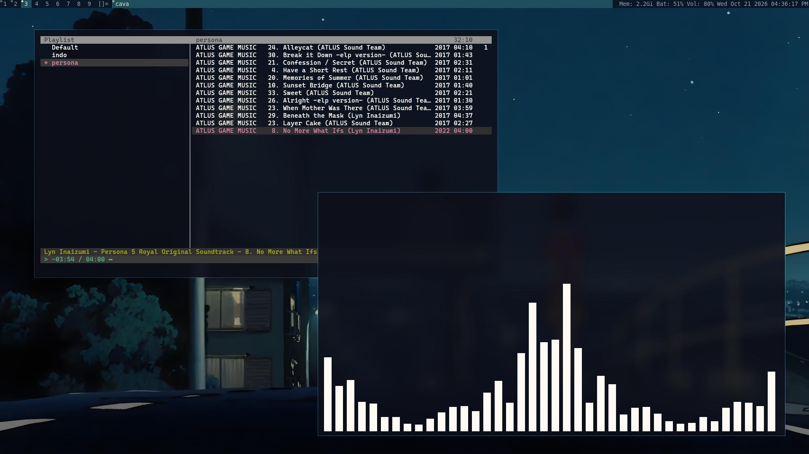

# dwm rice

My personal [dwm](https://dwm.suckless.org/) setup with all patches already applied. No manual patching needed, just clone, build, and go.

## Patches

- [bar-height](https://dwm.suckless.org/patches/bar_height/)
- [fullgaps](https://dwm.suckless.org/patches/fullgaps/)
- [moveresize](https://dwm.suckless.org/patches/moveresize/)
- [noborderfloatingfix](https://dwm.suckless.org/patches/noborder/)
- [movestack](https://dwm.suckless.org/patches/movestack/)
- [pertag](https://dwm.suckless.org/patches/pertag/)
- [status2d](https://dwm.suckless.org/patches/status2d/)
- [warp](https://dwm.suckless.org/patches/warp/)
- [xrdb](https://dwm.suckless.org/patches/xrdb/)

The `patches/` folder is kept for reference and credit only. They are already applied to the source.

## Dependencies

    sudo apt install build-essential libx11-dev libxft-dev libxinerama-dev git fontforge python3-fontforge fonts-font-awesome

## Font

The layout symbol uses a cat glyph from [waycat](https://github.com/CarloCattano/waycat) by CarloCattano. The original font maps its frames to plain letters, which clashes with normal text in dwm, so the glyphs are moved to the private use area first. The font file is not included in this repo, the script below builds it from the original:

    ./fonts/install-waycat.sh

Check that it is installed:

    fc-list | grep -i waycat

Without the font, the layout symbol shows an empty box. To skip it, edit the `layouts[]` array in `config.h` and remove the `\uE000` glyphs.

## Installation

    git clone https://github.com/vq6oon/dwm.git
    cd dwm
    ./fonts/install-waycat.sh
    sudo make clean install

Then add this line to your `~/.xinitrc`:

    exec dwm

## Status bar

The status bar is a separate project: [sxstatus](https://github.com/vq6oon/sxstatus). It uses the same cat font for the animated CPU cat, so install the font first.

## Theme from wallpaper (optional)

Bar colors follow the wallpaper using [pywal](https://github.com/dylanaraps/pywal) and the xrdb patch. The status bar colors from [sxstatus](https://github.com/vq6oon/sxstatus) follow too.

    sudo apt install xdotool pipx nitrogen
    pipx install pywal
    ./pywal/install.sh

Pick a wallpaper in nitrogen, then run `theme` (or press `MODKEY+w`). It regenerates the colors from the wallpaper, reloads the bar and restarts sxstatus.

To keep the colors after login, add this to `~/.xsessionrc` before dwm starts:

    xrdb -merge ~/.cache/wal/dwm-xres

Without pywal, dwm simply uses the colors set in `config.h`. Warning colors in the status bar (medium, low, mute) stay fixed on purpose, so they stay readable on any wallpaper.

## Configuration
All settings live in `config.h`. Edit it, then rebuild with `sudo make clean install` and restart dwm.

| Key | Action |
|---|---|
| `MODKEY+w` | refresh colors from wallpaper (needs pywal) |
| `MODKEY+Shift+F5` | reload bar colors from X resources |

## Credits

Based on [dwm](https://dwm.suckless.org/) by suckless.org. Original license is in `LICENSE`, original readme in `README.dwm`.

Cat font by [CarloCattano/waycat](https://github.com/CarloCattano/waycat).