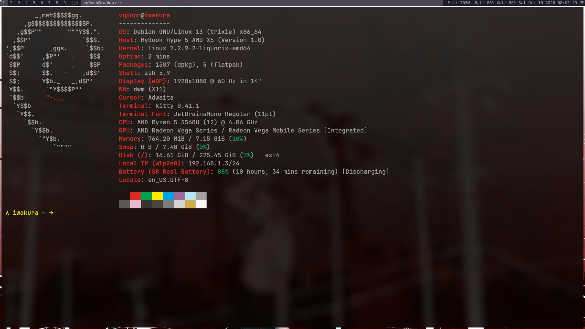

# dwm rice

My personal [dwm](https://dwm.suckless.org/) setup with all patches already applied. No manual patching needed, just clone, build, and go.

  

## Patches

- [bar-height](https://dwm.suckless.org/patches/bar_height/)
- [fullgaps](https://dwm.suckless.org/patches/fullgaps/)
- [moveresize](https://dwm.suckless.org/patches/moveresize/)
- [noborderfloatingfix](https://dwm.suckless.org/patches/noborder/)
- [movestack](https://dwm.suckless.org/patches/movestack/)

The `patches/` folder is kept for reference and credit only. They are already applied to the source.

## Dependencies

    sudo apt install build-essential libx11-dev libxft-dev libxinerama-dev

Font: (add the font you use here)

## Installation

    git clone https://github.com/vq6oon/dwm.git
    cd dwm
    sudo make clean install

Then add this line to your `~/.xinitrc`:

    exec dwm

## Configuration

All settings live in `config.h`. Edit it, then rebuild with `sudo make clean install` and restart dwm.

## Credits

Based on [dwm](https://dwm.suckless.org/) by suckless.org. Original license is in `LICENSE`, original readme in `README.dwm`.